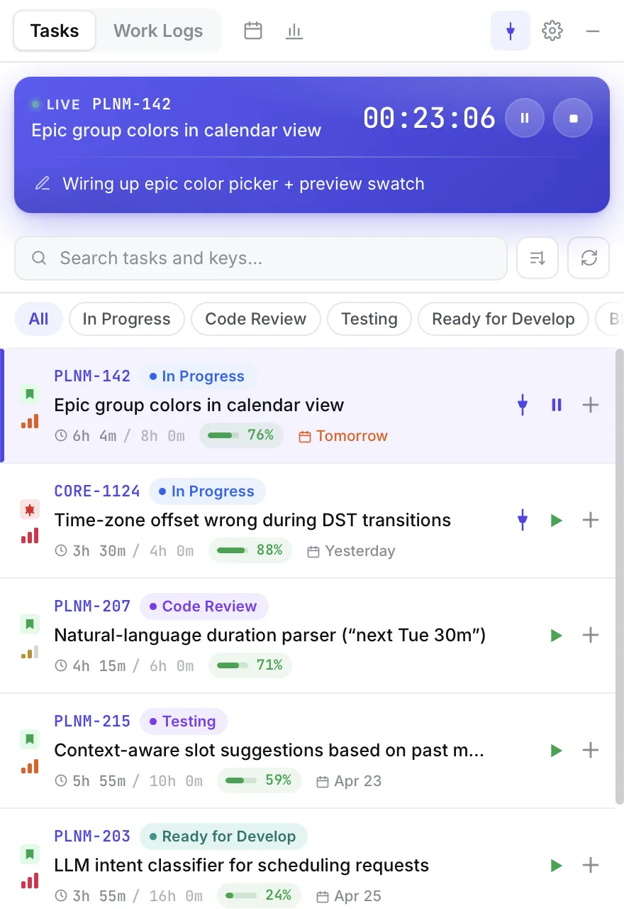
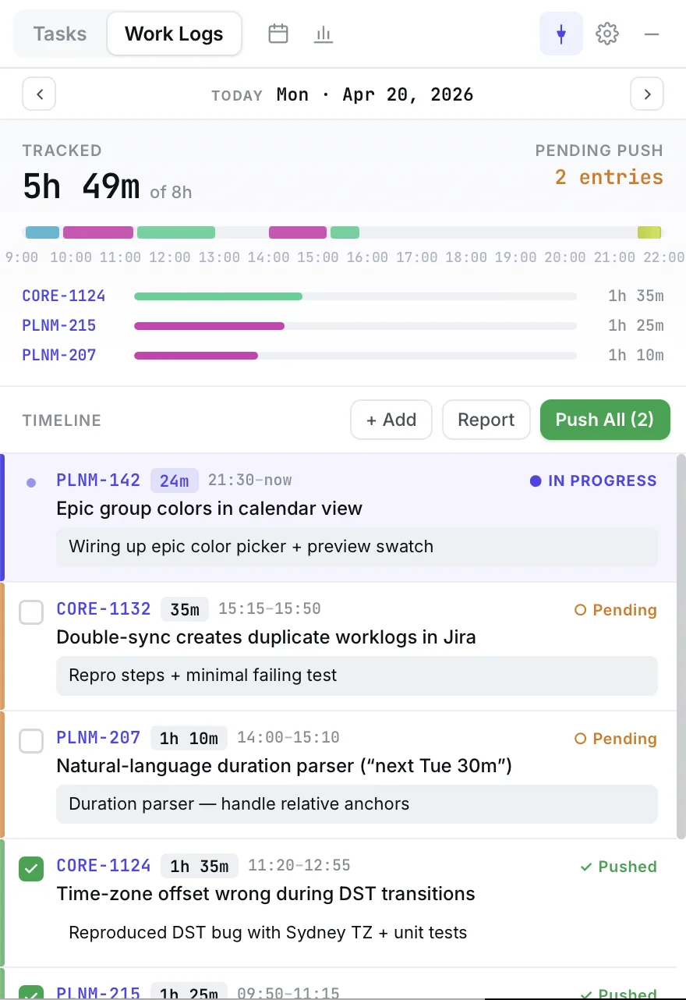
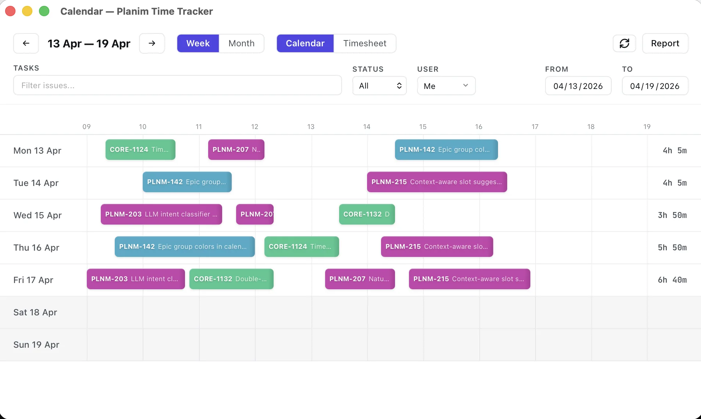
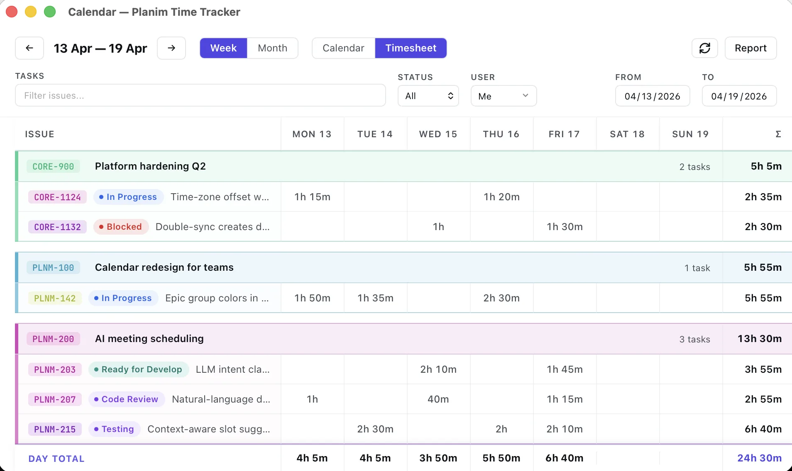
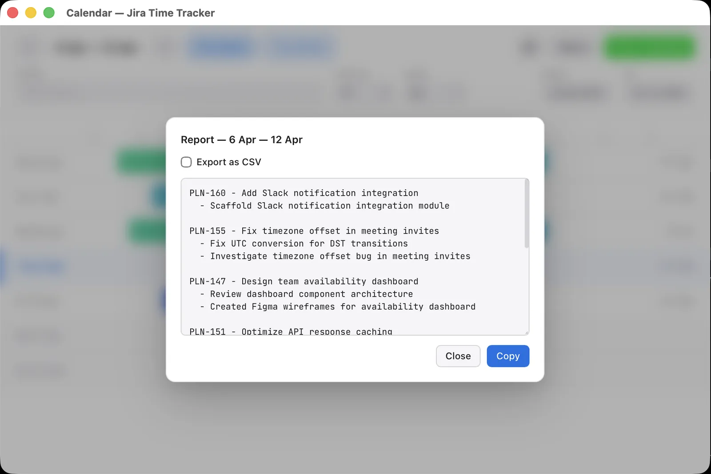
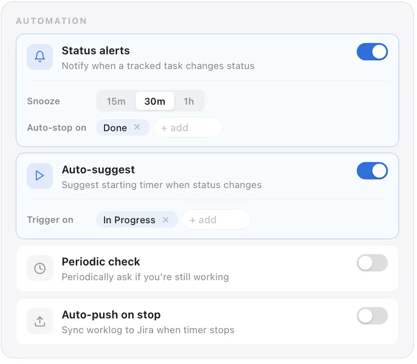
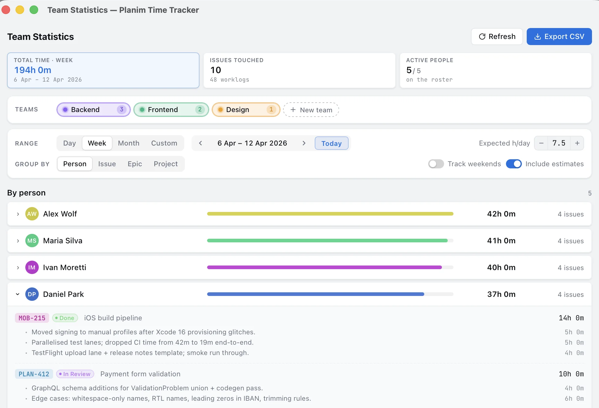

# Planim Time Tracker

**Jira time tracker for your menu bar.**
A native desktop app for macOS, Windows, and Linux: one-click timers, two-way Jira worklog sync, a weekly calendar, reports, and idle detection, all without leaving your workflow.

<a href="https://time.planim.app/jira/download?ref=github"><strong>Download</strong></a> ·
<a href="https://time.planim.app/jira?ref=github#pricing">Pricing</a> ·
<a href="https://time.planim.app/changelog?ref=github">Changelog</a> ·
<a href="https://time.planim.app/blog?ref=github">Blog</a> ·
<a href="https://time.planim.app/jira/vs?ref=github">Comparisons</a>

 

<picture>
  <source media="(prefers-color-scheme: dark)" srcset="screenshots/tasks-dark.webp">
  
</picture>

> **About this repository.** This is the public home of Planim Time Tracker: product overview, screenshots, and links. The app ships as signed installers from [time.planim.app](https://time.planim.app/jira/download?ref=github); the source code is not published here.

## Why another Jira time tracker

Most Jira time trackers are Cloud plugins. They live inside a browser tab, need an active Jira session, and are built for finance departments, agencies, or managers who want screenshots and activity scores. None of them are built for the engineer who just wants a timer that doesn't lose hours when Jira goes dark for five minutes.

Planim Time is a native desktop app: Rust under the hood, a tiny installer, one menu-bar icon, no browser tab. Sign in with Atlassian in one click, and long-lived credentials stay in the OS keychain. Worklogs round-trip through Jira's own API, so nothing gets stuck in a third-party silo. Open a plane-mode laptop, start a timer, land, push, done.

- **No Jira admin needed.** No Marketplace install, no plugin approval. Works with the access you already have.
- **No monitoring.** No screenshots, no keystrokes, no activity scores. It's a timer, not surveillance.
- **Offline-first.** Every worklog lives in a local SQLite file. Sync when you're back online.

## Features

### One-click timer

Pick an issue from your list and hit play. The timer counts in the menu bar, and the tray icon changes when it's running, paused, or idle. Bring your own JQL filter, reorder statuses to match how you actually work, pin the issues you live on, and sort by "last worked on" so the current task stays on top.

### Two-way worklog sync

Planim Time doesn't just push worklogs to Jira; it pulls them too. Push a single entry or everything at once, edit a worklog and push the change back, and see exactly where each entry stands with **In Progress**, **Pending**, and **Synced** badges. First launch imports the worklogs you already logged, so there's no blank slate.

<picture>
  <source media="(prefers-color-scheme: dark)" srcset="screenshots/worklogs-dark.webp">
  
</picture>

### Calendar and timesheet (Pro)

See every logged hour as color-coded blocks on a weekly calendar, or flip to the timesheet grid for a spreadsheet-style roll-up by issue and day. Drag a block to move it, resize it to retime it, and click it to edit the time, the description, or even the issue. The calendar syncs itself with Jira whenever you open it or change the period.

<picture>
  <source media="(prefers-color-scheme: dark)" srcset="screenshots/calendar-dark.webp">
  
</picture>

<picture>
  <source media="(prefers-color-scheme: dark)" srcset="screenshots/timesheet-dark.webp">
  
</picture>

### Worklogs from your Jira activity

Forgot to start the timer? The **Recent work** sidebar reads your Jira trail (issues you were assigned, commented on, created, or moved) and proposes time blocks. Suggestions preview on the calendar as draggable "ghost" blocks. Review, adjust, and add with one click.

### Reports (Pro)

Generate a report for any date range: every issue you worked on, with descriptions of what was done and totals per issue and per day. Export to CSV for invoicing, or copy your day grouped by issue straight into standup.

<picture>
  <source media="(prefers-color-scheme: dark)" srcset="screenshots/report-dark.webp">
  
</picture>

### Automation and idle detection (Pro)

Automate the tedious parts. Get notified when a tracked issue changes status in Jira, let the app suggest starting the timer when you move an issue, push worklogs automatically when you stop the timer, and let the app push anything that has been sitting unsynced for too long.

Step away with the timer running, or let the laptop sleep overnight, and idle detection asks what to do with the gap: keep it, subtract it and keep working, or stop the timer at the moment you left. Nothing is discarded silently (macOS and Windows). Working-hours reminders tell you when nothing is being tracked during your schedule and when you've hit your daily target.

<picture>
  <source media="(prefers-color-scheme: dark)" srcset="screenshots/automation-dark.webp">
  
</picture>

### Team statistics (Pro)

Group your people into teams, pick a week, and every worklog on every issue rolls up into one screen. Switch between person, issue, epic, and project views and expand any row to read the actual worklog descriptions. Two blocks managers actually open: **Missing time** compares logged hours against expected hours per weekday, and **Estimate vs Actual** puts the worst overruns first.

<picture>
  <source media="(prefers-color-scheme: dark)" srcset="screenshots/team-overview-dark.webp">
  
</picture>

### Your credentials, never plaintext

Sign in with Atlassian by default, or use an API token as a fallback. Long-lived credentials are stored in your operating system's secure credential store, never in a config file: macOS Keychain, Windows Credential Manager, or Secret Service (libsecret, GNOME Keyring, KWallet) on Linux. The API token never leaves your machine. OAuth exchange and refresh pass through a short-lived broker, but no long-lived Jira credential is retained on our backend.

### Small details

- **Dynamic tray icon** shows at a glance whether a timer is running, paused, or idle.
- **Pinned issues** stay at the top even when JQL would hide them behind a sprint boundary.
- **Status reordering**: drag In Progress above To Do and the list follows.
- **Daily report, one copy**: your day grouped by issue with descriptions, ready to paste.
- **Import existing worklogs** from Jira on first launch.
- **Dark, light, or system theme**, and animations respect the OS "reduce motion" setting.
- **Low background CPU**: the timer ticks in the native backend, so the app truly sleeps while hidden.
- **Auto-updates** with release notes straight from the changelog.

## Download

Get the latest build from the [download page](https://time.planim.app/jira/download?ref=github), or grab it directly:

| Platform | Requirements | Direct link |
|---|---|---|
| macOS | Apple Silicon, macOS 11+ | [`.dmg`](https://cdn.planim.app/time-jira/downloads/Planim-Time-Tracker-latest-macOS-arm64.dmg) |
| Windows | x64 | [`.exe` installer](https://cdn.planim.app/time-jira/downloads/Planim-Time-Tracker-latest-Windows-x64-setup.exe) |
| Linux | x64 | [`.AppImage`](https://cdn.planim.app/time-jira/downloads/Planim-Time-Tracker-latest-Linux-x64.AppImage) · [`.deb`](https://cdn.planim.app/time-jira/downloads/Planim-Time-Tracker-latest-Linux-x64.deb) |

Free to use, no account required. Release history is on the [changelog](https://time.planim.app/changelog?ref=github).

### Getting started

1. Install the app. It lives in your menu bar (system tray), with no dock icon.
2. Click the tray icon and open **Settings**.
3. Pick **Atlassian account** and approve the app in your browser, or pick **API token** and paste your Jira URL, email, and an [API token](https://id.atlassian.com/manage-profile/security/api-tokens).
4. Your issues load from the default JQL filter. Adjust the filter, status order, and pins to taste.
5. Hit play on an issue. Stop when you're done, and push the worklog to Jira.

## How it compares

Honest, feature-by-feature comparisons with the tools most teams evaluate alongside Planim Time:

- [Planim Time vs Tempo Timesheets](https://time.planim.app/jira/vs/tempo?ref=github)
- [Planim Time vs Clockwork](https://time.planim.app/jira/vs/clockwork?ref=github)
- [Planim Time vs Clockify](https://time.planim.app/jira/vs/clockify?ref=github)
- [Planim Time vs Everhour](https://time.planim.app/jira/vs/everhour?ref=github)
- [Planim Time vs Hubstaff](https://time.planim.app/jira/vs/hubstaff?ref=github)
- [Planim Time vs Toggl Track](https://time.planim.app/jira/vs/toggl?ref=github)

## Guides

From the [Planim Time blog](https://time.planim.app/blog?ref=github):

- [How to track time in Jira: every method, ranked by friction](https://time.planim.app/blog/how-to-track-time-in-jira?ref=github)
- [How to log work in Jira: the worklog dialog, JQL, and the API](https://time.planim.app/blog/how-to-log-work-in-jira?ref=github)
- [How to change logged hours in Jira: edit, move, and delete worklogs](https://time.planim.app/blog/how-to-change-logged-hours-in-jira?ref=github)
- [Two-way Jira worklog sync: how to verify it](https://time.planim.app/blog/two-way-jira-worklog-sync?ref=github)
- [Jira automatic time tracking: what "automatic" really means](https://time.planim.app/blog/jira-automatic-time-tracking?ref=github)
- [The best Jira time trackers for engineering teams in 2026](https://time.planim.app/blog/best-jira-time-trackers-for-engineers?ref=github)
- [Free Jira time trackers in 2026: which ones are actually free](https://time.planim.app/blog/free-jira-time-trackers?ref=github)
- [Jira time tracking without admin rights: what actually works](https://time.planim.app/blog/jira-time-tracking-without-admin-rights?ref=github)
- [Offline Jira time tracking: what still works when Jira is down](https://time.planim.app/blog/offline-jira-time-tracking?ref=github)
- [Leaving Tempo: a working playbook for moving Jira worklogs](https://time.planim.app/blog/migrate-from-tempo-to-desktop-tracker?ref=github)
- [Jira time tracker for Mac](https://time.planim.app/blog/jira-time-tracker-for-mac?ref=github) · [for Windows](https://time.planim.app/blog/jira-time-tracker-for-windows?ref=github) · [for Linux](https://time.planim.app/blog/jira-time-tracker-for-linux?ref=github)

## Tech stack

Tauri 2 · Rust · Svelte 5 · TypeScript · SQLite

## Links and support

- Website: [time.planim.app/jira](https://time.planim.app/jira?ref=github)
- Download: [time.planim.app/jira/download](https://time.planim.app/jira/download?ref=github)
- Changelog: [time.planim.app/changelog](https://time.planim.app/changelog?ref=github)
- Blog: [time.planim.app/blog](https://time.planim.app/blog?ref=github)
- Support: [support@planim.app](mailto:support@planim.app)
- [Privacy Policy](https://time.planim.app/privacy?ref=github) · [Terms of Service](https://time.planim.app/terms?ref=github)

Found a bug or missing a feature? Open an [issue](https://github.com/JorryGo/public-time-tracker/issues) here or write to [support@planim.app](mailto:support@planim.app).
